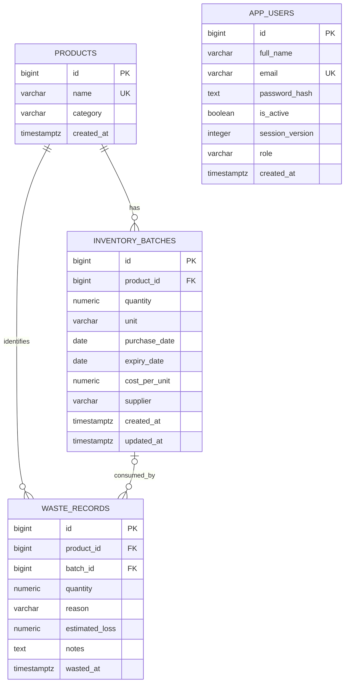

# FreshTrack Database Design

## Architecture and database responsibilities

The Next.js server routes use PostgreSQL for the application’s authoritative inventory and waste records. PostgreSQL constraints and a transaction protect structured relationships and stock deductions. MongoDB stores best-effort activity event documents in `inventory_events`; it is an audit/analytics side store, not the source of truth for stock.

PostgreSQL and MongoDB do not share a transaction. If PostgreSQL commits but MongoDB is unavailable, the application keeps the committed business record and logs the event-write failure. The event log can therefore be incomplete and must not be used to reconstruct inventory.

## Entity relationship diagram

Login reads accounts from `app_users`. Protected routes check the current role, active status and session version in PostgreSQL. Administrators manage staff accounts and inventory. Staff can read inventory and record waste.

## Relational data dictionary

| Table | Column | Type | Purpose / constraint |
|---|---|---|---|
| `products` | `id` | `bigserial` | Primary key |
| `products` | `name` | `varchar(150)` | Required, unique product name |
| `products` | `category` | `varchar(60)` | Required category; defaults to `Other` |
| `products` | `created_at` | `timestamptz` | Creation timestamp |
| `inventory_batches` | `id` | `bigserial` | Primary key |
| `inventory_batches` | `product_id` | `bigint` | Required FK to `products.id`; deletion restricted |
| `inventory_batches` | `quantity` | `numeric(12,2)` | Required stock; must be non-negative |
| `inventory_batches` | `unit` | `varchar(20)` | Required measurement unit |
| `inventory_batches` | `purchase_date` | `date` | Required purchase date |
| `inventory_batches` | `expiry_date` | `date` | Required; must not precede purchase date |
| `inventory_batches` | `cost_per_unit` | `numeric(12,2)` | Required, non-negative; defaults to zero |
| `inventory_batches` | `supplier` | `varchar(150)` | Required supplier name; defaults to empty text |
| `inventory_batches` | `created_at` | `timestamptz` | Creation timestamp |
| `inventory_batches` | `updated_at` | `timestamptz` | Updated by `trg_batch_updated_at` |
| `waste_records` | `id` | `bigserial` | Primary key |
| `waste_records` | `product_id` | `bigint` | Required FK to `products.id`; deletion restricted |
| `waste_records` | `batch_id` | `bigint` | Optional FK to `inventory_batches.id`; set null if batch is deleted. The UI derives its display unit from this batch when available. |
| `waste_records` | `quantity` | `numeric(12,2)` | Required and greater than zero |
| `waste_records` | `reason` | `varchar(80)` | Required waste reason |
| `waste_records` | `estimated_loss` | `numeric(12,2)` | Required, non-negative; defaults to zero |
| `waste_records` | `notes` | `text` | Required notes; defaults to empty text |
| `waste_records` | `wasted_at` | `timestamptz` | Waste timestamp; defaults to current time |
| `app_users` | `id` | `bigserial` | Primary key |
| `app_users` | `full_name` | `varchar(120)` | Required user name |
| `app_users` | `email` | `varchar(255)` | Required, unique email |
| `app_users` | `password_hash` | `text` | bcrypt hash checked during sign-in |
| `app_users` | `role` | `varchar(20)` | Server-enforced `admin` or `staff` role |
| `app_users` | `is_active` | `boolean` | Controls access for this account |
| `app_users` | `session_version` | `integer` | Invalidates existing tokens when access or credentials change |
| `app_users` | `created_at` | `timestamptz` | Creation timestamp |

## MongoDB event document

The current collection is `smart_food_waste.inventory_events`. Application writes use fields `type`, `entityType`, `entityId`, `details`, and `createdAt`. Event types include inventory creation/update and waste recording. The details object is event-specific. Event insertion is best effort after the PostgreSQL operation commits.

## Database features already present

- Primary keys, foreign keys, unique constraints, and quantity/date checks.
- `v_inventory_expiry_risk` view for active batches.
- `trg_batch_updated_at` trigger for batch updates.
- Indexes for batch expiry, product relationships, and waste date/product lookups.
- A stock deduction and waste insert in one PostgreSQL transaction.
- Core SQL examples in [`../sql/important_queries.sql`](../sql/important_queries.sql); its transaction demonstration rolls back.
